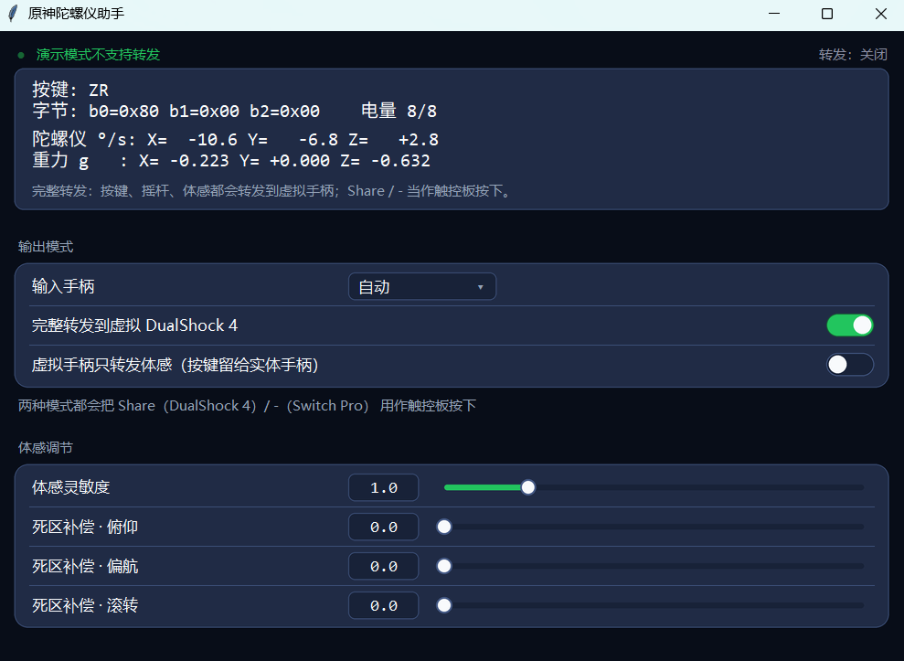

<div align="center">

# 原神陀螺仪助手

### 让第三方手柄的陀螺仪，在原神里真的能用

把实体手柄的按键、摇杆、体感逐字段转发成一只**虚拟有线 DualShock 4** ——
原神认这个，而你手里拿的仍然是你自己的手柄。

v1.4.0 起还能转发成一只**虚拟 DualSense（PS5 手柄）**，并加上**PS5 手柄原生震动**：
游戏发给 DualSense 的触觉音频会被读回来，驱动你手里那只实体手柄震动。

**免费 · 开源 · 无广告 · 不修改任何游戏文件**

[**下载**](https://github.com/bigguoba/GenshinGyro/releases) · [它适合你吗](#它适合你吗) · [常见问题](#常见问题) · [技术笔记](docs/tech.md)

[](https://github.com/bigguoba/GenshinGyro/releases)
[](LICENSE)
[](#开始使用)



</div>

**这个软件只为原神的体感功能而做。** 我没有在其他游戏上做过测试，其他游戏的体验不作保证。

## 它解决的到底是什么问题

原神只认它自己支持的那几只手柄。大量第三方手柄明明带陀螺仪，但接上电脑进原神之后，
结局只有三种：**完全没反应**、**按键错乱到没法控制**、或者**按键能用但体感纹丝不动**。
三种情况的共同点是：体感用不了。

本程序不去改游戏，也不去刷手柄固件。它做的是：在 Windows 上创建一只**虚拟的有线 DualShock 4**，
把实体手柄的按键、摇杆、体感按协议换算后逐字段转发进去。
游戏看到的是它支持的那只 DS4，体感自然就通了。

## 它适合你吗

三条同时满足才用得上：

1. **你的手柄有陀螺仪硬件。** Xbox 手柄没有陀螺仪，因此不在适用范围内。
2. **手柄能切换到 NS 模式（Switch Pro 协议）或 DS4 模式（Sony 协议）。**
   号称 NS 模式但走的不是标准 Switch Pro 协议的手柄，不在考虑范围内——现实中我也没见过。
3. **实体手柄直连电脑时，原神没法正常用它。** 具体是哪种"没法用"，见下一节。

## 该开哪个模式：看原神的反应，不看有线还是蓝牙

同一只手柄换根线、换个连接方式，原神的反应就可能不一样。所以别记"有线怎么配、蓝牙怎么配"，
直接看游戏里的实际表现：

| 原神对手柄的反应 | 需要本软件吗 | 开哪个模式 | HidHide |
|---|---|---|---|
| **按键和体感都能正常用** | 不需要 | — | — |
| **能读按键，但体感不动** | 需要 | **虚拟手柄只转发体感** | **不要** |
| **键值错乱，根本没法控制**（NS 模式必然如此） | 需要 | **完整转发** | **必须** |
| **完全没反应，游戏里什么都读不到** | 需要 | **完整转发** | **不要** |

> 表里没有「转发到虚拟 DualSense」：那个模式转发的**内容**和"完整转发"完全一样，
> 只是虚拟手柄换成一只 DS5。它在原神里解决不了上面任何一种情况，
> 存在的理由是**震动**（游戏只往 DualSense 写触觉音频）以及只认 DS5 的其他游戏。
> 想一边转发一边有震动，就开它。

### HidHide 到底藏不藏：一句话规则

> **HidHide 只在"原神看得见这只手柄、但读错了"的时候才需要。**

- 原神**看得见但读错**（NS 模式）→ **必须藏**，不藏就键值错乱
- 原神**根本看不见** → **不用藏**，藏了也没区别
- 原神**要用它读按键**（"能读按键、体感不动"那种）→ **不能藏**，
  藏了实体手柄的按键也一起没了

## 已经验证过的组合

下面这些是我自己实测跑通的组合。**除这两个型号外，我没有其他第三方手柄可以测试**，
所以其他型号请自行验证——理论上只要满足上面三条适用条件都能用。

| 手柄 | 模式 | 原神直连时的表现 | 怎么配 | 结果 |
|---|---|---|---|---|
| 山弯 Q34U | **NS**（蓝牙 / 有线） | 键值错乱，无法控制 | 完整转发 + HidHide | ✅ 可用 |
| 山弯 Q34U | DS4（蓝牙） | 认按键、不认体感 | 仅体感 | ✅ 可用 |
| 良值 卡片手柄 | **NS**（蓝牙） | 键值错乱，无法控制 | 完整转发 + HidHide | ✅ 可用 |
| 良值 卡片手柄 | DS4（蓝牙） | 按键体感都不认 | 完整转发（无需 HidHide） | ✅ 可用 |

> 另一条实践下来省事的经验：**DS4 模式的手柄先试有线直连**，原神有可能本来就认（按键体感都正常），
> 那就完全不需要这个软件。山弯 Q34U 的 DS4 模式有线直连就是这样。

## 它能做什么

**输入**：任何走 Switch Pro 协议（NS 模式）或 Sony 协议（DS4 模式）的手柄，有线或蓝牙
**输出**：虚拟 DualShock 4（ViGEmBus）或虚拟 DualSense（VIIPER，可选）

| 功能 | 说明 |
|---|---|
| 完整转发 | 按键、摇杆、扳机、体感、电量全部由虚拟手柄发出 |
| 仅体感 | 虚拟手柄只发体感，按键摇杆留给实体手柄 —— 用于"原神认按键但不认体感"的情况 |
| 转发到虚拟 DualSense | 与"完整转发"同样的内容，但虚拟手柄是一只 **DualSense**。给只认 DS5 才发触觉/自适应扳机的游戏用；需要 VIIPER 服务（程序会自动尝试启动） |
| 体感灵敏度 | 0.1 – 10.0，只缩放角速度，不动加速度（否则游戏判断倾斜的参考就毁了） |
| 三轴死区补偿 | 俯仰 / 偏航 / 滚转各自独立，单位 °/s，低于 0.5 °/s 不补，所以静止不会漂 |
| Share / - → 触控板 | 每个转发模式下都可用；蓝牙下触控板按键不灵，这是最靠得住的位置 |
| PS5 手柄原生震动 | 把游戏写给虚拟 DualSense 的触觉音频（回环采集）实时转成实体手柄震动。四种组合（DS4 / NS Pro × 有线 / 蓝牙）都在真手柄上验过。七个可调项：强度、灵敏度、起振、拖尾、轻音过滤、响应曲线、低频/高频分界，另加左右分工开关；每个参数在界面上都有一行说明，"恢复默认"一键复位 |
| × 与 ○ 互换，□ 与 △ 互换 | 交换虚拟手柄的两对面键，对虚拟 DualShock 4 与虚拟 DualSense 都生效。只动这四个键，十字键、肩键、扳机、Share 都不受影响 |
| 设置记忆 | 转发模式、灵敏度、三个补偿值、键位互换、震动的十个参数全部写进 exe 旁边的 `settings.json`，下次启动沿用 |

## 它不做什么

- **不做按键重映射、宏、连发** —— 只做转发（键位互换只是交换虚拟手柄的两对面键，不改实体手柄）
- **不读写游戏内存、不注入进程、不修改任何游戏文件。** 它只搬手柄的 HID 报文，
  属于外设模拟，不是外挂
- **其他游戏未经验证。** 本软件为原神而做，别的游戏能不能用没有测试过
- **震动只走"音频触觉"这一条路。** 游戏必须真的往 DualSense 音频端点写触觉音频才会有震动；
  只发普通 rumble 输出报文的游戏（大多数 PC 游戏）不会触发它。手柄本身也不能是 Xbox 那种没有触觉的马达结构 —— DS4 / NS Pro 都验过
- **不带 VIIPER，也不带 usbip-win2 驱动。** 这两样都是独立的第三方组件
  （GPL-3.0 / 2-Clause BSD），需要你自己装一次 / 下一份放到程序旁边（见下一节）

## 驱动与可选工具

本程序自身不安装任何驱动，但虚拟手柄来自 **ViGEmBus**；虚拟 DualSense 与震动还要
**usbip-win2** 驱动（装一次）。**VIIPER 已经随包附带**，不用自己下载；
另外有一个可选的 **HidHide**，在上面那张表里有时是"必须"、有时是"绝对不要"。

| 组件 | 必需？ | 作用 | 不做会怎样 |
|---|---|---|---|
| **ViGEmBus** | 用虚拟 DualShock 4 时必需 | 创建虚拟手柄的内核驱动 | 程序能开，但永远不出现虚拟 DualShock 4 |
| **usbip-win2** | 用虚拟 DualSense / 震动时必需 | USB/IP 的内核驱动 + `usbip.exe`（VIIPER 的底层） | VIIPER 起不来或报「usbip-win2 驱动没找到」，那两个功能都用不了 |
| **VIIPER** | 用虚拟 DualSense / 震动时必需（**已随包附带**） | 本地 USB/IP 设备代理，创建虚拟 DualSense 和它的音频端点 | 别删发行包里的 VIIPER-*.exe，删了会报「没找到 VIIPER-*.exe」；虚拟 DualShock 4 不受影响 |
| **HidHide** | 视情况 | 把实体手柄从其他程序眼里藏起来 | NS 模式不装会键值错乱；"认按键不认体感"的情况装了反而坏 |

### ViGEmBus（必需）

虚拟 DualShock 4 不是软件画出来的，而是这个驱动创建的设备。
Linux 上对应的是内核自带的 `uhid`/`hid-playstation`，Windows 上必须单独装。

1. 打开 [ViGEmBus Releases](https://github.com/nefarius/ViGEmBus/releases)
2. 下载最新 `ViGEmBus_*_x64.exe` 并安装（需要管理员权限）
3. 提示重启就重启
4. 装完后「设备管理器」里能看到 `Nefarius Virtual Gamepad Emulation Bus` 一类条目即可

> 装完驱动后**手柄不需要做任何事**：虚拟手柄由本程序在运行时创建，
> 关掉程序就一起消失，不会在系统里留下一个常驻的假手柄。

### usbip-win2（虚拟 DualSense / 震动才需要，装一次）

VIIPER 造出来的"虚拟 USB 设备"要靠 **USB/IP** 这个协议挂进 Windows，而 USB/IP 需要一个
内核驱动 —— Windows 上没有自带的，用的是 [usbip-win2](https://github.com/vadimgrn/usbip-win2)
（2-Clause BSD，签名驱动）。**装一次就行，之后开机自动可用。**

1. 打开 [usbip-win2 0.9.7.7 发布页](https://github.com/vadimgrn/usbip-win2/releases/tag/v.0.9.7.7)
2. 下载 x64 的安装包（`usbip-win2-0.9.7.7-x64.exe` 或同版本 MSI），管理员权限安装
3. 提示重启就重启

> **版本要对**：VIIPER 是照 `usbip-win2 0.9.7.7` 写的，装了别的版本它会直接报
> 「USB/IP prerequisite failed: VIIPER requires usbip-win2 0.9.7.7」。装错了就卸掉重装这一个版本。
>
> **装到哪**：默认是 `C:\Program Files\USBip\`，里面有 `usbip.exe`。VIIPER 会自己去这个位置找，
> **不需要手动加 PATH**；如果你装到别处，要把那个目录加进 PATH，否则 VIIPER 会报
> 「USB/IP tool 'usbip.exe' not found in PATH」。
>
> 装完可以用管理员 cmd 运行 `usbip list -l` 验证：能列出本机 USB 设备就说明驱动正常。

### VIIPER（虚拟 DualSense / 震动才需要，已随包附带）

[VIIPER](https://github.com/alia5/VIIPER/releases) 是一个独立的本地 USB/IP 设备代理
（GPL-3.0，上游的原始二进制，见 [NOTICE](NOTICE.txt) 与 `viiper-LICENSE.txt`）。
它负责创建虚拟 DualSense 和那只手柄的音频端点。

**发行包里已经带了 `VIIPER-0.1.9-rc4.6.6-x64.exe`**，和 `GenshinGyro.exe` 在同一层，
所以什么都不用下载：打开「转发到虚拟 DualSense」或「PS5 手柄原生震动」时，
程序会自己把它拉起来。唯一的前提是上面那个 usbip-win2 驱动已经装好。

> 想换更新的 VIIPER：把新版 exe 放进同一目录、删掉旧的即可（程序按 `VIIPER-*.exe` 找）。

> 出问题时先单独跑一次 VIIPER：双击 `VIIPER-*.exe`，它会自己开一个控制台并把
> 「usbip-win2 driver found / not found」写在第一行 —— 那行就是问题所在。

> **系统里永远只有一台「扬声器 (DualSense Wireless Controller)」，名字不带前缀。**
> 这不是小事：游戏是按名字找输出设备的，而 Windows 有个规则 —— 当系统里已经有一只
> DualSense 设备时，**另建**出来的音频设备会被叫成「2- DualSense Wireless Controller」，
> 游戏就永远找不到它、也就不会往里写触觉音频（震动就没了）。
>
> 所以：转发到虚拟 DualSense 时，音频接口**长在手柄这只设备上**
> （VIIPER 的 `dualsensecombinedaudioduplexv5`），名字自然是干净的；震动开关打开时
> **复用它那台**，不另建。只开震动、不开转发时，才由震动自己建一台只带音频的
> （`dualsenseaudioonlyduplexv5`，那时系统里没有第二只 DualSense，名字同样干净）。
> 两种开法（先震动后转发 / 先转发后震动）都实测过，最终都只剩一台、名字没前缀。

### HidHide（NS 模式必须，其它情况按表格判断）

HidHide 是一个过滤驱动 + 配置工具，能把指定的实体手柄"藏"起来，让别的程序看不见它。
NS 模式必须用它，因为原神会把 NS 模式手柄识别成错误的东西，导致键值错乱、完全没法操作。

安装与配置：

1. 安装 [HidHide](https://github.com/nefarius/HidHide/releases)（需要管理员权限，装完重启）
2. 打开 **HidHide Configuration Client**
3. **Devices** 页：勾选你的实体手柄
4. **Applications** 页：把 `GenshinGyro.exe` 加进白名单
   —— **不加的话，本程序自己也会看不到手柄**
5. 勾选启用隐藏（`Enable device hiding`），然后重新打开本程序

> 改完 HidHide 一定要**重开本程序**：手柄的可见性在打开设备时就确定了。
> 如果之后手柄"消失了"，先把隐藏关掉，再排查别的原因。

## 开始使用

1. **先装 ViGEmBus**（见上一节）。
2. 到 [Releases](https://github.com/bigguoba/GenshinGyro/releases) 下载最新的
   `GenshinGyro-vX.Y.Z-win64.zip`，
   **解压到整个文件夹**——不要把 exe 单独拖出来，它旁边的 `_internal` 是必需品。
3. 双击解压目录里的 **`GenshinGyro.exe`**。
4. 按上面那张表判断原神怎么反应，选对应的模式；NS 模式记得先配好 HidHide。

**要求**：Windows 10 / 11 **x64** + ViGEmBus（用虚拟 DualSense 或震动时另需 usbip-win2 驱动 + VIIPER）。
不需要装 Python，运行时不联网。
手柄用 USB 或蓝牙都行，蓝牙需要先在系统里配对好。

> **首次运行会被 Windows 拦一次。** exe 没有数字签名，会弹「Windows 已保护你的电脑 / 未知发布者」。
> 点「**更多信息**」→「**仍要运行**」即可。这是没有购买代码签名证书的必然结果，不是文件有问题。

> 想要**控制台模式**（不弹窗口、直接转发）：打开 cmd，cd 到解压目录，运行
> `GenshinGyro.exe --cli`（整机转发）、`--cli --source ds4 --motion-only`（仅体感）等。
> 发行包不再附带 `启动-*.bat`，所有入口就是 exe 本身。

## 常见问题

<details>
<summary><b>界面能打开，但一直显示未连接</b></summary>

按一下手柄上的任意键唤醒它。蓝牙手柄休眠后需要一次按键才会重新上报。
还是不行就看两件事：手柄是否已经**在 Windows 设置里配对过**（不是在游戏里配对）；
以及是否装了 HidHide 而**忘了把 `GenshinGyro.exe` 加进白名单**——那会让本程序自己看不到手柄。
</details>

<details>
<summary><b>开了之后游戏里按键乱跳 / 完全没法控制</b></summary>

九成是该藏而没藏：NS 模式必须用 HidHide 把实体手柄隐藏，否则原神会同时读到两只手柄的输入。
按上面的规则检查 HidHide 的 Devices（勾了实体手柄吗）和 Applications（加了 `GenshinGyro.exe` 吗），
改完**重开本程序**。
</details>

<details>
<summary><b>按键正常，但体感一点反应都没有</b></summary>

先确认你开的是「完整转发」还是「仅体感」：
原神读不读得到体感，取决于它认不认你的手柄。试试换成另一个模式。
另外，实体蓝牙手柄有时会退回"最小报文"模式（不包含体感数据），程序会自动重新请求，恢复不了就关掉重开一次。
</details>

<details>
<summary><b>体感有，但镜头太灵敏 / 有点抖</b></summary>

把「体感灵敏度」调低一点。画面偏航是按报文积分出来的，灵敏度过高会被过度放大。
三个死区补偿不是"调方向"用的，默认 0.0 就是正确状态。
</details>

<details>
<summary><b>开了震动，但手柄不震</b></summary>

先看界面底部那行状态：

- **「PS5手柄原生震动：关闭」** —— 开关没开，或者上次因为建不出音频端点被自动关掉了
  （状态行会写原因，比如 VIIPER 没在跑）。
- **「音频端点已就绪，等待手柄连接…」** —— 手柄还没被程序拿到，按一下手柄任意键唤醒。
- **「已开启（扬声器 (DualSense Wireless Controller) [Loopback]）」** —— 一切正常，
  这时候手柄不震只可能是"游戏没往这个端点写触觉音频"：原神会写；别的大多数 PC 游戏只会发
  普通 rumble 报文，这条路收不到。

几个已知的坑：

1. **VIIPER 不在**：震动需要它建音频端点。`VIIPER-*.exe` 必须待在 `GenshinGyro.exe` 旁边。
2. **系统里一台「扬声器 (DualSense …)」都没有** → 震动开关没真正打开（看状态行），
   或者开关打开时音频端点建失败、被自动弹回去了。
3. **蓝牙手柄偶发没反应**：程序每次开震动都会自己开一个 HID 句柄；如果手柄刚好在休眠，
   先按一下键唤醒，再把开关关/开一次。
</details>

<details>
<summary><b>震动强度 / 灵敏度怎么调</b></summary>

七个滑块，每个下面都有一行说明：

- **强度** 是总倍率，先调这个。
- **灵敏度** 是"多大的声音才开始震"，原神里觉得没反应就调大。
- **起振** 越大越"硬"（一下就到位），越小越"软"。
- **拖尾** 是余震长度（掉到 10% 的时长），30 ms 一下就停，900 ms 会拖很长。
- **轻音过滤** 用来压掉背景音的低强度抖动；**响应曲线** 调前段迟钝还是猛；
  **低频/高频分界** 决定左右两个马达谁吃哪一段（配合"左右分工"）。

调乱了点卡片右下角的「恢复默认」，回到原来「低频沉浸」那一档。
</details>

<details>
<summary><b>和 DS4Windows / Steam 冲突吗</b></summary>

会。同时只能有一个程序以独占方式读同一只手柄。
测试和游玩时请只运行本程序，并关掉 Steam 对该游戏的输入接管。
</details>

## 已经验证到什么程度

不是"在我机器上能跑"就发布：

- **真手柄逐项核对 33/33 全部通过**，无需任何修正：18 个按键、十字键 4 向、双摇杆 8 向、
  体感三轴正负号、静止零偏、平放重力。
- **987 项自动断言**（`tools/` 下 9 个脚本）覆盖报文解析、单位换算、按键映射、
  蓝牙中继、设置读写、界面步进、震动引擎、虚拟 DualSense 状态打包。
- 震动在**真手柄**上验过四种组合（DS4 / NS Pro × 有线 / 蓝牙），并在真 VIIPER 上验过
  设备创建/清理、250 Hz 输入流、触摸点、声卡与转发互不干扰。
- 校准值来自实测：一台真实 Switch Pro 手柄的出厂标定算出陀螺仪系数 **0.0617 °/s per count**，
  正好落在 "±2000 dps 精确换算（61 mdps/digit）" 上 —— 说明按手柄自身标定换算是正确的。
- 第三方手柄按上面的表格**在真机、真游戏里逐项验证过**（山弯 Q34U、良值卡片手柄）。

```bat
python tools\test_end_to_end.py      :: 92 项
python tools\test_ds4_relay.py       :: 108 项
python tools\test_gui_flow.py        :: 133 项
python tools\test_haptics.py         :: 382 项
python tools\test_viiper.py          :: 67 项
python tools\test_verify_plan.py     :: 74 项
python tools\test_rumble.py          :: 54 项
python tools\test_settings.py        :: 67 项
python tools\test_ds4_output_path.py :: 10 项
```

## 从源码运行

需要 Python 3.12（标准库即可；装了 Pillow 会启用抗锯齿渲染）。
震动功能另需 `numpy` 与 `pyaudiowpatch`（`pip install numpy pyaudiowpatch`）；
虚拟 DualSense 与震动还需要 usbip-win2 驱动和 `VIIPER-*.exe`（见「驱动与可选工具」）。

```bat
python main.py --gui              :: 图形界面
python main.py --gui --demo       :: 没有手柄也能预览界面
python main.py --list             :: 列出系统里的 HID 设备
python main.py                    :: 命令行直接转发
python main.py --backend dualsense --haptics   :: 命令行：虚拟 DualSense + 震动
build_exe.bat                     :: 重新打包（加 onefile 出单文件版）
```

各版本改动见 [CHANGELOG.md](CHANGELOG.md)，协议细节与实测数据见 [docs/tech.md](docs/tech.md)。

## 参与

[报告问题](https://github.com/bigguoba/GenshinGyro/issues) 时请附上：手柄型号、连接方式、原神里的实际表现
（按键认不认、体感动不动）、Windows 版本、你选的模式。Bug 模板会提示这些都填什么。

这个软件站在很多前人的肩膀上：dekuNukem 的 Switch 逆向笔记、Linux 内核的 `hid-nintendo.c` 与
`hid-playstation.c`、SDL3 的 HIDAPI、ViGEm 与 HidHide。第三方组件与出处见 [NOTICE.txt](NOTICE.txt)。

以 [MIT](LICENSE) 许可发布。Nintendo Switch、DualShock、原神均为各自公司的商标，
本项目与其无隶属关系，商标仅用于说明兼容性。
